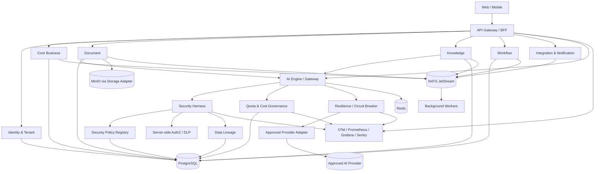

# Core Platform Technical Specification V2.2
## Architecture & Security Hardening

**Status:** Active engineering baseline  
**Supersedes:** V2.1 wherever conflicting  
**Date:** 24 November 2026

> AI coding agents must read `docs/README.md` and Governance V2.2 before each task. Do not extend V2.1 assumptions. Deviations require an ADR and human approval.

## 1. Architecture decisions

Keep the current stack: Next.js/React/TypeScript; Python/FastAPI; gRPC; PostgreSQL/pgvector; Redis; NATS JetStream; MinIO through Storage Adapter; Docker; OpenTelemetry, Prometheus/Grafana, Sentry and GitHub Actions. No Kubernetes/Kafka requirement for MVP.

Platform principles:
- API-first, multi-tenant, stateless APIs and background workers.
- Domain service owns its schema, migrations and DB role.
- No direct cross-service database reads/writes and no cross-service foreign keys. Exchange references through gRPC/events.
- NATS is at-least-once; use transactional outbox/inbox, idempotent consumers and deduplication. Do not claim exactly-once.
- All AI paths use AI Gateway + Security Harness. No direct provider egress from domain services, workers, cron, browser clients or coding agents.
- Unknown classification is blocked. C2/C3 are prohibited from external AI. C3 is excluded from AI processing unless separately approved isolated workflow permits it.
- Policy, authorization, DLP, lineage or quota failure must fail closed for protected operations.
- Sensitive raw payloads, prompts, OCR text, retrieved chunks, secrets and provider credentials must not enter telemetry.
- Human approval required for high-impact external actions, destructive operations, financial approvals and privileged changes.

## 2. Target architecture

## 3. Service inventory and ownership

| Service/module | Responsibility | Owned schema |
|---|---|---|
| Gateway/BFF | Auth boundary, trusted context, rate limiting, API composition | gateway config |
| Identity & Tenant | Organizations, users, memberships, roles, tenant lifecycle | identity |
| Core Business | Workspaces and shared business entities | core |
| Document | Upload, metadata, versioning, OCR orchestration | document |
| Knowledge | Knowledge bases, chunks, embeddings, retrieval | knowledge |
| Workflow | Definitions, tasks, approvals, execution | workflow |
| Integration & Notification | Connectors, webhooks, email, notifications | integration |
| AI Engine/Gateway | Model routing, prompt execution, provider adapters | ai |
| Security Policy Registry | Versioned policies and approvals | security |
| Data Lineage | Source/derived graph and lifecycle propagation | lineage |
| Quota & Cost Governance | Reservations, metering, budgets and reconciliation | governance |
| Resilience | Provider health, circuit state and fallback profiles | resilience/config |

Control-plane capabilities may initially be modules in AI Engine/Core Business, but must preserve explicit interfaces, ownership and audit boundaries. Split into separate services only when justified by scale or isolation requirements.

## 4. Security Policy Registry

Registry is authoritative for classification/processing rules, AI purpose eligibility, provider/model/region allowlists, retention, tool permissions, approval requirements, quota/budget limits and resilience/fallback profiles.

Policy lifecycle: `DRAFT → REVIEW → APPROVED → ACTIVE → SUPERSEDED/REVOKED`.
Each immutable version stores policy ID, version, scope, effective dates, status, content hash, creator, approver, approval time and change ticket/ADR. Changes create a new version. Rollback reactivates a previously approved version; never rewrite history.

Resolve policy server-side from trusted tenant, actor, purpose, resource classification, feature and provider context. Caller-supplied policy IDs, classifications and allow flags are not authority. Revalidate immediately before provider egress and tool execution. Expired, revoked, stale, invalid or unavailable policy means DENY for protected operations. Cache keys include tenant, scope and version; activation invalidates caches.

## 5. Classification, authorization and Data Lineage

| Level | Meaning | External AI |
|---|---|---|
| C0 | Public | Only under approved policy |
| C1 | Internal | Only explicit tenant policy + approved provider |
| C2 | Confidential | Prohibited |
| C3 | Restricted | Prohibited; default excluded from AI |
| UNKNOWN | Unclassified/uncertain | Blocked |

Classification is assigned by trusted ingestion rules or authorized reviewer. Transformations cannot lower it. OCR, normalized text, chunks, embeddings, caches, summaries, retrieval contexts and outputs inherit the highest parent classification and intersection of parent ACLs.

Lineage graph: `source_asset → OCR/extracted artifact → normalized artifact → chunk → embedding → retrieval_context → ai_request → ai_output`.
Each node stores tenant/resource identity, classification, ACL/policy version, content fingerprint (not raw content), storage reference, processor/version, retention class and deletion state. Edges record parent/child and transformation provenance.

Knowledge must perform current server-side tenant/resource authorization before RAG context assembly. Caller `allowed_resource_ids` is never sufficient. Cache partition includes tenant + principal/role + ACL version + policy version. Revocation invalidates caches and pending contexts. Delete/revoke propagates to object derivatives, chunks, embeddings, indexes, caches and queued jobs; incomplete deletion remains visible and retried. No raw content in lineage tables.

## 6. Quota & Cost Governance

Meter by tenant, actor, module, feature, provider, model, request, time window and type: input/output tokens, embeddings, OCR pages, storage bytes, egress bytes, workflow runs and connector calls. Keep provider-reported actuals separate from estimates.

Admission sequence:
1. Authenticate and authorize.
2. Resolve policy and quota.
3. Estimate maximum usage/cost.
4. Atomically reserve quota/budget.
5. Execute.
6. Reconcile actual usage and release unused reservation.
7. Write immutable usage ledger and audit event.

Reservation failure denies or queues by policy; never silently bypasses quota. Retried operations reuse idempotency key and cannot double-charge. Track actual/estimated charges for failed requests if provider billing applies.

Support soft warnings, hard limits, burst allowances, concurrency caps, per-tenant daily/monthly budgets, per-model caps and emergency kill switch. Recommended alert defaults: 70/85/100%; make thresholds configurable. Admin overrides require reason, expiry and audit. Version rate cards; preserve historic calculations; isolate tenant cost views.

## 7. Resilience, circuit breaker and operations

All network calls have connect/read/overall deadlines. Retry only transient failures, with bounded exponential backoff + jitter and respect for Retry-After. Do not retry policy denial, validation failure or non-idempotent actions. Require idempotency keys for AI generation, document processing, workflow, billing and connector actions.

Circuit breaker states: `CLOSED`, `OPEN`, `HALF_OPEN`; configurable by provider/model/operation. OPEN rejects fast; HALF_OPEN permits bounded probes; close only after configured successes. Circuit state is observable and transitions audited. Restart defaults safely.

Fallback only after fresh policy evaluation and only to approved provider/model with equivalent or stricter classification, region, retention, training-use and capability constraints. Fallback never converts DENY to ALLOW. Use bulkheads/concurrency caps for OCR, embeddings, AI, connectors and workflows. Use DLQ, poison-message controls and audited redrive. Graceful degradation may queue non-urgent work or disable optional AI; it must not bypass authz, policy, quota or approval.

Docker Compose is for development and controlled pilot, not production HA. Separate liveness/readiness/dependency health. Monitor latency, error rate, queue age/depth, DLQ, circuit state, provider spend, quota/policy denials and lineage deletion lag. Use sanitized telemetry, encrypted/offsite backups and scheduled restore drills. CI gates include unit/integration/contract/E2E, SAST, SCA, secret scan, IaC/container scan, migration checks and security acceptance tests. Use a production secret manager and rotate credentials. Review MinIO licensing/support, lifecycle and restore before production.

## 8. Database and contracts

Add control-plane migration `implementation/sql/08-control-plane-v2.2.sql` with:
- `security.policy_versions`, `security.policy_approvals`, `security.policy_decisions`
- `lineage.nodes`, `lineage.edges`, `lineage.deletion_jobs`
- `governance.quota_policies`, `governance.usage_reservations`, `governance.usage_ledger`, `governance.rate_cards`
- `resilience.circuit_states`, `resilience.provider_health_events`

Remove cross-service FKs from deployed V2.1 only after schema inventory, backup, clone migration test and reviewed constraint-removal migration. This baseline does not authorize blind destructive migration.

gRPC control-plane contract: `implementation/proto/controlplane/v1/controlplane.proto`; covers ResolvePolicy/RevalidateDecision, lineage node/edge/deletion, ReserveUsage/ReconcileUsage/GetQuota, provider route and circuit state/outcome. Tenant/actor must be authenticated and validated server-side. Mutations require idempotency and correlation IDs. Never return raw content or secrets.

## 9. Request flow and dependency rules

Protected AI flow:
`Gateway → trusted context → server-side AuthZ → policy resolve → classification/lineage validation → quota reserve → RAG assembly with current ACL → policy revalidate → approved resilience route → provider → output scan/classification → lineage output → usage reconcile → safe audit`.

Synchronous service validation uses gRPC. Asynchronous integration uses NATS JetStream with outbox/inbox and idempotent consumers. No direct database coupling between services.

## 10. Security acceptance and release gates

Retain SEC-001…SEC-015 and add SEC-016…SEC-025 in `implementation/backlog/acceptance-matrix.csv`:
- SEC-016 forged caller classification/AI permission is rejected.
- SEC-017 stale/revoked policy blocks provider egress.
- SEC-018 ACL revoke blocks RAG and invalidates cache.
- SEC-019 lineage deletion reaches chunks, embeddings, indexes, caches and jobs.
- SEC-020 reservation/reconciliation is atomic and retry-safe.
- SEC-021 circuit opens during provider outage; fallback is policy-approved only.
- SEC-022 policy/lineage/quota outage fails closed.
- SEC-023 no cross-service FK or direct runtime DB access.
- SEC-024 no raw sensitive payload in telemetry.
- SEC-025 tenant usage/cost/circuit data is isolated.

Release gates for protected AI paths: zero C2/C3 canaries in provider payload; zero provider egress bypass; zero cross-tenant retrieval/usage disclosure; all protected operations deny when mandatory control dependencies fail; zero raw sensitive payload in telemetry; all tests have reproducible evidence and independent review. These gates cover tested scope, not proof of no unknown vulnerabilities.

## 11. Delivery phases

| Phase | Priority | Scope | Exit criteria |
|---|---|---|---|
| 0 Baseline freeze | P0 | Freeze V2.1, inventory code/schema/egress, ADR and migration plan | Team/agents acknowledge V2.2 |
| 1 Security foundation | P0 | Trusted context, AuthZ, mandatory Harness, provider egress deny, fail-closed | SEC-001…017 pass |
| 2 Policy & Lineage | P0/P1 | Registry lifecycle, inheritance, lineage graph, deletion, RAG ACL | SEC-018/019 pass |
| 3 Quota & Cost | P1 | Metering, reservation, ledger, rate cards, budgets | SEC-020/025 pass |
| 4 Resilience & Ops | P1/P2 | Deadlines, retry, circuit breaker, fallback parity, bulkhead, DLQ, dashboards | SEC-021/022 + chaos tests pass |
| 5 Production hardening | P2 | CI scans, secrets, backups, restore, runbooks, SLOs, load/soak | Operational readiness review |

## 12. Definition of Done

A task requires: V2.2/ADR compliance; additive documented API/proto/schema changes; tenant/classification/ACL/policy/quota/lineage enforcement server-side; positive and negative tests including outage, cross-tenant and idempotency where relevant; safe observability; migration/rollback plan; reproducible CI evidence; independent human review for security work; and an accurate report of commands, results and residual risks.
