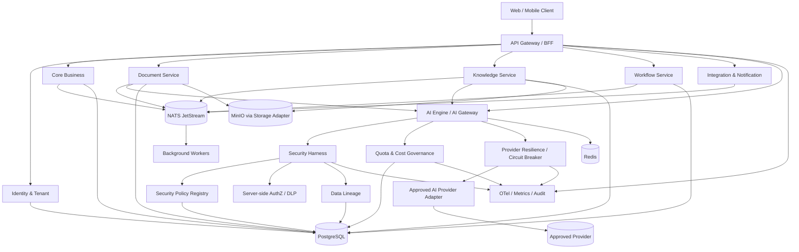
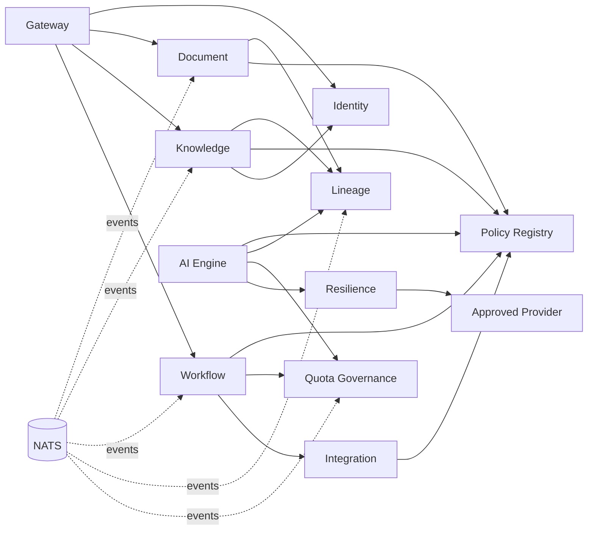

# Core Platform Technical Specification V2.2
## Architecture & Security Hardening
**Status:** Approved engineering baseline for new implementation  
**Supersedes:** Core Platform Technical Specification V2.1 and all conflicting V2.1 implementation assumptions  
**Scope:** Multi-tenant SaaS core platform for AI Office / AI Ops Desk and modular SME products  
**Date:** 24 November 2026

> **Mandatory instruction to AI coding agents:** V2.2 is the sole authoritative technical baseline. Do not extend V2.1 where it conflicts with this document. Before changing code, read this specification, `docs/adr/`, `docs/security/`, SQL migrations, proto contracts and the implementation backlog. Any ambiguity or deviation requires an ADR and human approval. Security controls are runtime enforcement requirements, not prompt instructions.

## 1. Executive decisions

V2.2 retains the existing stack and modular domain architecture. It closes the security and operational gaps identified in the V2.1 review by adding a shared Security & Governance Control Plane:

1. **Security Policy Registry** — versioned, approved, auditable policies for classification, AI provider/model eligibility, retention, tool permissions, quotas and resilience.
2. **Data Lineage** — traceable relationships between source documents, OCR, normalized text, chunks, embeddings, retrieval contexts, AI requests and outputs; supports ACL revocation, retention and deletion propagation.
3. **Quota & Cost Governance** — tenant/user/module/provider/model budgets, usage metering, hard/soft limits, reservations, reconciliation and cost attribution.
4. **Resilience & Circuit Breaker** — bounded timeouts, retries with jitter, idempotency, circuit breakers, bulkheads, provider health, approved fallback and graceful degradation.
5. **Security enforcement** — mandatory AI Security Harness, server-side authorization, classification inheritance, fail-closed behavior and network egress controls.

**No stack replacement.** Keep Next.js/React/TypeScript, Python/FastAPI, gRPC, PostgreSQL/pgvector, Redis, NATS JetStream, MinIO, Docker, OpenTelemetry, Prometheus/Grafana, Sentry and GitHub Actions. Do not introduce Kubernetes or Kafka for the MVP.

## 2. Architecture principles and non-negotiable invariants

- API-first, multi-tenant, stateless APIs; background workers for long-running work.
- Each service owns its schema, migrations and runtime DB role. No cross-service table reads/writes and **no cross-service foreign keys**. Cross-domain references are UUIDs validated via owning service APIs/events.
- Synchronous service calls use gRPC; asynchronous integration uses NATS JetStream with transactional outbox/inbox, idempotent consumers and at-least-once semantics. Never claim exactly-once delivery.
- Every request has trusted tenant/user context established by Identity/Gateway. Caller-supplied tenant, classification, role, policy decision or ACL list is untrusted.
- Default deny for tenant access, resource access, AI use, tool use and provider egress.
- Classification is monotonic: transformations cannot lower classification. OCR, extracted text, chunks, embeddings, caches, summaries and outputs inherit the maximum applicable classification and ACL restrictions.
- All AI paths pass through AI Gateway + Security Harness. No direct provider calls from domain services, workers, cron jobs, browser clients or coding agents.
- C2/C3 data must not be sent to external AI providers. C3 restricted data is excluded from AI processing unless a separately approved, isolated internal workflow explicitly permits it. Unknown classification is blocked.
- Policy, DLP, authorization, lineage or quota control-plane failure must fail closed for protected operations. Safe read-only degradation is permitted only when explicitly defined in policy.
- Raw sensitive payloads, prompts, retrieved chunks, OCR text, secrets and provider credentials must not be written to logs, traces or metrics.
- Human approval is required for high-impact external actions, financial approvals, permission changes, destructive operations and workflow actions designated by policy.

## 3. Target architecture

### 3.1 Service inventory

| Component | Responsibility | Data ownership |
|---|---|---|
| API Gateway/BFF | Authentication boundary, request context, rate limiting, API composition | gateway config only |
| Identity & Tenant | Users, organizations, memberships, roles, tenant lifecycle | `identity` |
| Core Business | Workspaces and shared business objects | `core` |
| Document | Upload, storage metadata, OCR orchestration, versions | `document` |
| Knowledge | Knowledge bases, chunks, embeddings, retrieval | `knowledge` |
| Workflow | Workflow definitions, tasks, approvals, execution state | `workflow` |
| Integration & Notification | Connectors, webhooks, email and notifications | `integration` |
| AI Engine / Gateway | Model routing, prompt execution, provider adapters | `ai` |
| Security Policy Registry | Versioned policy bundles and approvals | `security` |
| Data Lineage | Derived-data graph and lifecycle propagation | `lineage` |
| Quota & Cost Governance | Metering, budget, reservation, reconciliation | `governance` |
| Resilience module | Provider health, circuit state, retry/fallback policy | `resilience` (initially module/config, not necessarily separate service) |

The control-plane capabilities may be implemented as modules in the AI Engine/Core Business for the MVP, but their interfaces, ownership and audit boundaries must remain explicit. Split into services only when scale/team/security boundaries justify it.

## 4. Security Policy Registry

### 4.1 Purpose and policy domains
The Registry is the authoritative, versioned source for:
- Data classification rules and allowed processing locations.
- Provider/model allowlists, region, retention and training-use constraints.
- AI purpose and feature eligibility.
- Tool allowlists, argument schemas, approval requirements and least-privilege scopes.
- Tenant/user/module quotas and budget policy.
- Retry, timeout, circuit-breaker and fallback profiles.
- Retention, deletion and legal-hold rules.

### 4.2 Policy lifecycle
`DRAFT → REVIEW → APPROVED → ACTIVE → SUPERSEDED/REVOKED`.
Every policy has immutable `policy_id`, semantic `version`, `scope`, `effective_from`, optional `effective_until`, `status`, `content_hash`, `created_by`, `approved_by`, approval timestamp and change ticket/ADR. Active policy versions are immutable; edits create a new version. Rollback means activating a previously approved version, never rewriting history.

### 4.3 Enforcement contract
- Resolve policy server-side using trusted tenant, actor, purpose, data classification, feature and provider context.
- Client-supplied policy IDs, classifications and `external_ai_allowed` flags are hints only and cannot authorize processing.
- Return a signed/opaque decision reference with `ALLOW`, `DENY` or `REQUIRE_APPROVAL`, reason code, policy version, expiry and decision ID.
- Revalidate immediately before provider egress and before tool execution; do not rely solely on an earlier decision.
- Registry unavailable, stale beyond configured TTL, invalid signature/hash or policy conflict => deny protected action.
- Policy changes emit `security.policy.activated.v1`; consumers invalidate caches. Cache keys include tenant, policy scope and version.

## 5. Data classification, authorization and lineage

### 5.1 Classification
| Level | Meaning | External AI |
|---|---|---|
| C0 Public | Public/approved-to-publish | Allowed only under approved policy |
| C1 Internal | Routine internal | Allowed only with explicit tenant policy and approved provider |
| C2 Confidential | Business confidential | Prohibited |
| C3 Restricted | Highly restricted | Prohibited; default prohibited even for internal AI |

Unknown/unclassified content is treated as blocked, not C0. Classification is assigned at ingestion by trusted server-side rules or an authorized reviewer. Users cannot lower classification through metadata edits.

### 5.2 Lineage graph
Required chain where applicable:
`source_asset → extracted/OCR artifact → normalized artifact → chunk → embedding → retrieval_context → ai_request → ai_output`.
Each node stores tenant, resource type/id, classification, ACL/policy version, content fingerprint (not raw content), storage reference, processor/version, created time, retention class and deletion state. Edges store transformation type, parent/child IDs and provenance.

### 5.3 Lineage enforcement
- Derived objects inherit the highest parent classification and the intersection of parent ACL permissions; no transformation may widen access.
- Before RAG context assembly, Knowledge performs server-side tenant and resource authorization against current ACL state. Caller-provided `allowed_resource_ids` is never sufficient.
- Cache partitioning includes tenant + principal/role + ACL version + policy version. Revocation invalidates caches and pending retrieval contexts.
- Delete/revoke propagates to chunks, embeddings, search indexes, caches, generated derivatives and queued jobs. Track completion and retry failures; unresolved deletion is visible as a security incident.
- Lineage records retain metadata sufficient for audit while payload deletion follows retention/legal-hold rules.
- Do not store raw content in lineage tables.

## 6. Quota and Cost Governance

### 6.1 Metering dimensions
Record usage by tenant, actor, module, feature, provider, model, request, time window and usage type: input/output tokens, embeddings, OCR pages, storage bytes, egress bytes, workflow executions and connector calls. Store provider-reported usage separately from estimated usage.

### 6.2 Admission and reservation
1. Authenticate and authorize.
2. Resolve active policy and quota.
3. Estimate maximum cost/units.
4. Atomically reserve budget/quota.
5. Execute work.
6. Reconcile actual usage and release unused reservation.
7. Emit immutable usage ledger entry and audit event.

If reservation fails, deny or queue according to policy; never silently bypass quota. Retries must reuse idempotency key and must not double-charge. Failed provider requests may incur billable cost; record actual/estimated charge with outcome.

### 6.3 Limits and controls
Support soft warning, hard limit, burst allowance, per-user concurrency, per-tenant daily/monthly budget, per-model caps and emergency kill switch. Alerts at configurable thresholds (recommended defaults 70/85/100%). Limits are policy-configurable, not hard-coded. Admin overrides require reason, expiry and audit record.

### 6.4 Cost integrity
- Store usage event ID, idempotency key, policy version, rate-card version, currency, unit price, estimated/actual cost, source and reconciliation status.
- Version rate cards; never rewrite historic cost calculations.
- Dashboard separates provider invoice actuals from internal estimates.
- Do not expose one tenant's usage or cost to another tenant.

## 7. Resilience, circuit breaker and operations

### 7.1 Required patterns
- Explicit connect/read/overall deadlines for every network call.
- Bounded retries only for transient failures; exponential backoff with jitter; respect `Retry-After`; no retry for policy denial, validation errors or non-idempotent actions.
- Idempotency keys for AI generation, document processing, workflow execution, billing and connector actions.
- Circuit breaker states `CLOSED`, `OPEN`, `HALF_OPEN`; thresholds/window/cooldown configurable per provider/model/operation.
- Bulkheads: separate worker pools and concurrency limits for OCR, embeddings, AI generation, connectors and workflow actions.
- Provider fallback only to an approved provider/model with equivalent or stricter data policy, region, retention and capability constraints. Re-run policy decision before fallback.
- Graceful degradation: queue non-urgent tasks, serve safe cached metadata, disable optional AI features; never bypass authorization, classification, quota or approval.
- Dead-letter queues with redrive controls, poison-message limits and operator audit.

### 7.2 Circuit breaker behavior
- `OPEN`: reject fast with stable error code; do not send provider request.
- `HALF_OPEN`: allow bounded probes; close only after configured successes.
- `CLOSED`: normal bounded traffic.
- Circuit state is observable and scoped by provider/model/operation. Redis may hold ephemeral state, but restart behavior must default safely and state transitions must be auditable.
- Circuit breaker must not transform a policy DENY into fallback ALLOW.

### 7.3 Operational baseline
- Docker Compose is for development and controlled pilot, not a claim of production HA.
- Health endpoints: liveness, readiness and dependency health are distinct.
- OTel traces/metrics/logs with correlation IDs; redact payloads and secrets.
- Prometheus/Grafana alerts for error rate, latency, queue age/depth, DLQ, circuit state, provider spend, quota denials, policy denials and lineage deletion lag.
- Sentry for sanitized application exceptions.
- Backups encrypted, access-controlled, offsite/immutable where feasible; scheduled restore drills.
- CI gates: unit/integration/contract/E2E, SAST, SCA, secret scan, IaC/container scan, migration checks and security acceptance suite.
- Secrets from managed secret store in production; rotate credentials; no secrets in repository or image.
- Review MinIO version/licensing/support and object lifecycle/backup design before production.

## 8. Database schema changes

V2.2 adds a dedicated migration `docs/implementation/sql/08-control-plane-v2.2.sql`. These tables are owned by control-plane modules and use tenant-scoped keys. Existing domain services must not query them directly; use gRPC contracts.

Core tables:
- `security.policy_versions`, `security.policy_approvals`, `security.policy_decisions`
- `lineage.nodes`, `lineage.edges`, `lineage.deletion_jobs`
- `governance.quota_policies`, `governance.usage_reservations`, `governance.usage_ledger`, `governance.rate_cards`
- `resilience.circuit_states`, `resilience.provider_health_events`

**DB ownership correction:** remove cross-schema foreign keys from V2.1 (notably AI→identity, Knowledge→core, Document→identity/core). Keep UUID references and validate through owner service APIs/events. The migration includes an audit query/checklist; actual FK drops must be generated against the deployed schema and reviewed before execution. Do not run destructive production migration automatically.

## 9. gRPC contracts

New contract: `controlplane.v1.ControlPlaneService` (proto at `docs/implementation/proto/controlplane/v1/controlplane.proto`):
- `ResolvePolicy` / `RevalidateDecision`
- `CreateLineageNode` / `CreateLineageEdge` / `PropagateDeletion`
- `ReserveUsage` / `ReconcileUsage` / `GetQuota`
- `EvaluateProviderRoute` / `ReportProviderOutcome` / `GetCircuitState`

Contract requirements:
- Trusted tenant and actor context comes from authenticated service identity/claims, not arbitrary request fields.
- Resource references include tenant and resource identity; server validates ownership and authorization.
- Mutating calls require idempotency key and correlation ID.
- Decision response returns policy version, decision ID, expiry and reason code.
- Never return raw content or secrets through control-plane APIs.
- Proto changes are additive and versioned; breaking changes require new API version + ADR.

## 10. Service dependencies and call flow

No direct DB dependencies across services. Every protected AI request follows:
`Gateway → trusted context → AuthZ → policy resolve → classification/lineage validation → quota reserve → prompt/RAG assembly with ACL → policy revalidate → provider resilience route → approved provider → output scan/classification → lineage output record → usage reconcile → audit`.

## 11. Security and acceptance gates

Retain SEC-001…SEC-015 from the V2.1 security policy and add:
- SEC-016: caller cannot forge classification or external-AI permission.
- SEC-017: stale/revoked policy blocks provider egress.
- SEC-018: RAG ACL revocation blocks context and invalidates cache.
- SEC-019: lineage deletion reaches chunks, embeddings, caches, indexes and queued jobs.
- SEC-020: quota reservation is atomic and retries do not double-charge.
- SEC-021: provider outage opens circuit; no unapproved fallback.
- SEC-022: policy/lineage/quota service outage fails closed.
- SEC-023: cross-service FK and direct cross-schema runtime access are absent.
- SEC-024: telemetry contains no raw sensitive payload.
- SEC-025: tenant usage, cost and circuit telemetry are isolated.

Release gate for protected AI paths:
- 0 C2/C3 canary content in outbound provider payload.
- 0 provider egress bypass.
- 0 cross-tenant retrieval or usage disclosure.
- 100% protected actions deny when required policy/authz/lineage/quota dependency is unavailable.
- 0 raw sensitive payload in telemetry.
- 100% security tests have reproducible evidence and independent review.
These gates describe tested scope; they do not prove absence of unknown vulnerabilities.

## 12. Delivery phases and backlog

| Phase | Priority | Scope | Exit criteria |
|---|---|---|---|
| 0 — Baseline freeze | P0 | Freeze V2.1, inventory code/schema, ADR approval, migration plan | Agent and team acknowledge V2.2 |
| 1 — Security foundation | P0 | Trusted context, server-side authz, Harness mandatory, egress deny, fail-closed | SEC-001…015 + 016/017 pass |
| 2 — Policy & lineage | P0/P1 | Registry lifecycle, classification inheritance, lineage graph, delete/revoke propagation, RAG ACL | SEC-018/019 pass; lineage audit |
| 3 — Quota & cost | P1 | Metering, reservations, reconciliation, rate cards, budget controls | SEC-020/025 pass; no double charge |
| 4 — Resilience & operations | P1/P2 | Timeouts, retry, circuit breaker, fallback parity, bulkheads, DLQ, dashboards, backup/restore | SEC-021/022 pass; chaos tests |
| 5 — Production hardening | P2 | CI security gates, secret management, restore drill, load/soak, runbooks | operational readiness review |

### 12.1 Backlog priority
**P0 — release blockers**
- V2.1 baseline freeze and dependency inventory.
- Remove untrusted caller authority for tenant, classification, ACL and policy.
- Mandatory Harness and provider egress allowlist.
- Server-side RAG ACL and fail-closed control-plane checks.
- Remove cross-service foreign keys and direct DB access.
- SEC-001…SEC-017 automation.

**P1 — required before broad commercial rollout**
- Security Policy Registry with immutable versioning and approval.
- Data Lineage for source-to-output graph and deletion propagation.
- Quota reservations, usage ledger, cost reconciliation and tenant budgets.
- Approved fallback parity, idempotency, outbox/inbox and retry controls.
- SEC-018…SEC-025 automation.

**P2 — operational maturity**
- Circuit breaker dashboards, chaos testing, bulkheads, DLQ operations.
- SAST/SCA/DAST/IaC/container scanning, secret manager and rotation.
- Immutable/offsite backups, restore drills, incident runbooks and SLOs.
- Load/soak testing and cost anomaly alerts.

## 13. Definition of Done for AI coding agents

A task is not complete unless:
1. V2.2 requirements and applicable ADRs are followed.
2. API/proto/schema changes are additive, documented and migration-safe.
3. Tenant isolation, classification, ACL, policy, quota and lineage checks are enforced server-side.
4. Tests include positive, negative, cross-tenant, outage/fail-closed and idempotency cases where applicable.
5. No direct provider egress or raw sensitive telemetry is introduced.
6. Observability is useful but payload-safe.
7. CI evidence, migration plan, rollback plan and updated docs are supplied.
8. Security-sensitive changes are reviewed by a human independent of the implementing agent.
9. Agent reports exact commands, results, known gaps and evidence; it must not claim tests passed without outputs.

## 14. ADR index
- ADR-001 Mandatory AI Security Harness
- ADR-002 No direct AI provider egress
- ADR-003 Classification inheritance and unknown=deny
- ADR-004 Server-side tenant and resource ACL
- ADR-005 Never trust caller-supplied classification/permission
- ADR-006 No raw sensitive telemetry
- ADR-007 Derived-data deletion via lineage
- ADR-008 No cross-service foreign keys/direct DB access
- ADR-009 Tool sandbox and least privilege
- ADR-010 Provider fallback policy parity
- ADR-011 Security Policy Registry as policy source of truth
- ADR-012 Data Lineage as derived-data governance graph
- ADR-013 Quota reservation and immutable usage ledger
- ADR-014 Circuit breaker and resilience boundaries

## 15. Migration and compatibility notes

- Do not attempt a blind in-place migration against production. First introspect actual schema, export FK inventory, create backup and test forward/rollback on a sanitized clone.
- Add control-plane schemas and APIs before enabling enforcement in callers. Use feature flags only to stage rollout; flags must not permit insecure bypass in production.
- Migrate existing documents to an explicit classification. Unknown records remain blocked until classified.
- Backfill lineage for existing derived assets where provenance is available; mark incomplete lineage and block sensitive RAG/AI use until remediated.
- Start usage metering in shadow mode, reconcile against provider billing, then enforce hard limits.
- Introduce circuit breakers in observe-only mode, validate thresholds, then enable fast-fail and approved fallback.
- Existing V2.1 SQL/proto contracts are not automatically safe. All cross-service FK and caller-authority issues must be resolved before production.
